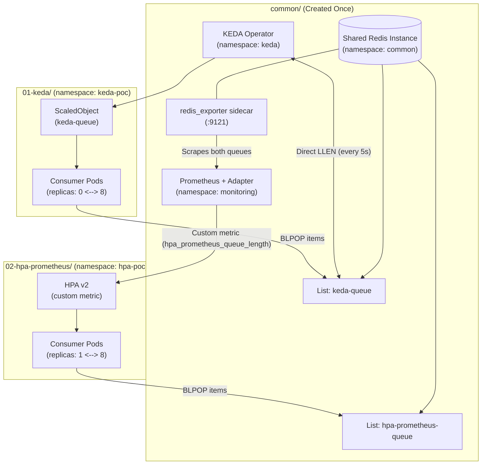

# Kubernetes Autoscaling PoC: KEDA vs Standard HPA with Custom Prometheus Metrics

A hands-on, reproducible Proof of Concept running on a local **Kind** cluster to compare two industry approaches to autoscaling queue-consuming workloads:

1. **KEDA (Kubernetes Event-driven Autoscaling)** via `keda-queue`
2. **Standard Kubernetes HPA + Prometheus Metrics Adapter** via `hpa-prometheus-queue`

Both approaches coexist simultaneously on the same cluster, sharing common cluster infrastructure (Redis, Exporter, KEDA, Prometheus) deployed once, and can be tested independently or concurrently.

---

## Architecture Overview



---

## Comparison Summary

| Dimension | KEDA (`01-keda`) | Standard HPA on K8s v1.37 (`02-hpa-prometheus`) |
| :--- | :--- | :--- |
| **Queue Target** | `keda-queue` | `hpa-prometheus-queue` |
| **Namespace** | `keda-poc` | `hpa-poc` |
| **Scale-to-Zero (0 replicas)** | **Supported natively** (KEDA operator activates 0 $\to$ 1) | **Supported in v1.37+** (`HPAScaleToZero` Beta enabled by default for External metrics) |
| **Scaling Latency** | **Fast (5–10s)**: Directly polls Redis `LLEN` every 5 seconds | **Delayed (20–40s)**: Metric traverses: Redis $\to$ Exporter $\to$ Prometheus scrape $\to$ Adapter poll $\to$ HPA loop |
| **Architectural Overhead** | 1 Helm chart (`keda`) | 3 extra components: Exporter sidecar + Prometheus Server + Prometheus Adapter |
| **Configuration Complexity** | 1 declarative `ScaledObject` pointing to Redis service & list name | Exporter flag config + Prometheus scrape rule + Prometheus Adapter PromQL rule + HPA v2 manifest |
| **Cluster Memory Usage** | ~70 MB | ~350–500 MB |

> [!TIP]
> 📖 **Deep Dive Analysis**: Read the detailed technical breakdown on [Scale-to-Zero Mechanics and Scaling Latency](docs/scale-to-zero-and-latency.md), covering the multi-hop metric pipeline, cold-start timelines, and cooldown/stabilization configurations.

---

## Prerequisites

- [Docker](https://docs.docker.com/) or [Colima](https://github.com/abiosoft/colima) (active and running)
- [kind](https://kind.sigs.k8s.io/) (`>= v0.20.0`)
- [kubectl](https://kubernetes.io/docs/tasks/tools/) (`>= v1.28.0`)
- [helm](https://helm.sh/) (`>= v3.12.0`)

---

## Project Structure

```
.
├── docs/
│   └── scale-to-zero-and-latency.md  # Detailed analysis of 0-replicas & scaling latencies
├── cluster/
│   ├── kind-config.yaml              # Kind cluster spec (K8s v1.37)
│   ├── setup-cluster.sh              # Creates Kind cluster & deploys common infrastructure
│   └── destroy-cluster.sh            # Deletes Kind cluster
├── common/
│   ├── install-common.sh             # Deploys Redis, Exporter, KEDA, and Prometheus
│   ├── load-generator.sh             # CLI tool to push/drain/inspect queues
│   └── manifests/
│       ├── namespace.yaml            # common, keda, monitoring
│       ├── redis-with-exporter.yaml  # Redis with sidecar exporter
│       ├── prometheus-values.yaml    # Fast-scrape Prometheus config
│       └── prometheus-adapter-values.yaml # Custom metric rules
├── 01-keda/
│   ├── README.md                     # Deep-dive guide
│   ├── deploy.sh                     # Deploys keda-poc namespace & ScaledObject
│   ├── test.sh                       # Runs 30-message test watching 0 -> 6 -> 0
│   ├── cleanup.sh                    # Deletes keda-poc namespace
│   └── manifests/
│       ├── namespace.yaml
│       ├── consumer.yaml             # Worker (replicas: 0)
│       └── scaledobject.yaml         # KEDA ScaledObject
├── 02-hpa-prometheus/
│   ├── README.md                     # Deep-dive guide
│   ├── deploy.sh                     # Deploys hpa-poc namespace & HPA
│   ├── test.sh                       # Runs 30-message test watching 0 -> 6 -> 0
│   ├── cleanup.sh                    # Deletes hpa-poc namespace
│   └── manifests/
│       ├── namespace.yaml
│       ├── consumer.yaml             # Worker (replicas: 0)
│       └── hpa.yaml                  # HPA v2 spec (minReplicas: 0)
└── README.md
```

---

## Quickstart

### 1. Create Cluster & Common Infrastructure
```bash
chmod +x cluster/*.sh common/*.sh 01-keda/*.sh 02-hpa-prometheus/*.sh
./cluster/setup-cluster.sh
```
This script will:
1. Create the `keda-vs-hpa` Kind cluster.
2. Deploy the shared Redis instance and metrics exporter in the `common` namespace.
3. Install KEDA in the `keda` namespace.
4. Install lightweight Prometheus and Prometheus Adapter in the `monitoring` namespace.

---

### 2. Test Approach 1: KEDA (Scale to Zero)
```bash
./01-keda/deploy.sh
./01-keda/test.sh
```
**What to observe:**
- **Baseline**: Ready replicas = `0` (Zero compute waste when queue is idle).
- **Scale-up**: Within 5–10 seconds of injecting 30 messages, pods rapidly scale out to `6` (`ceil(30 / 5)`).
- **Scale-to-zero**: Once messages are processed and cooldown (20s) elapses, pods scale cleanly back down to `0`.

---

### 3. Test Approach 2: Standard HPA + Prometheus
```bash
./02-hpa-prometheus/deploy.sh
./02-hpa-prometheus/test.sh
```
**What to observe:**
- **Baseline**: Ready replicas = `1` (HPA cannot scale to zero; an idle pod is permanently active).
- **Scrape Latency**: Notice the ~20-30s delay while the metric traverses Redis $\to$ exporter $\to$ Prometheus $\to$ Adapter $\to$ HPA.
- **Scale-up**: Once registered, pods scale out to `6`.
- **Scale-down**: After queue empties, pods scale down and stop at `1` (never drops to 0).

---

### 4. Direct Queue Operations (Load Generator)
You can use the helper script at any time to inspect queues or push custom load:
```bash
# Check current queue lengths and active replica counts
./common/load-generator.sh status

# Push 50 messages to KEDA queue
./common/load-generator.sh push keda-queue 50

# Push 50 messages to HPA queue
./common/load-generator.sh push hpa-prometheus-queue 50

# Immediately empty a queue
./common/load-generator.sh drain keda-queue
./common/load-generator.sh drain hpa-prometheus-queue
```

---

### 5. Tear Down
To destroy the entire local cluster:
```bash
./cluster/destroy-cluster.sh
```
