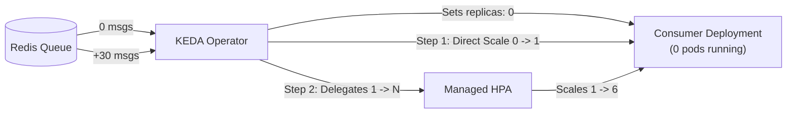
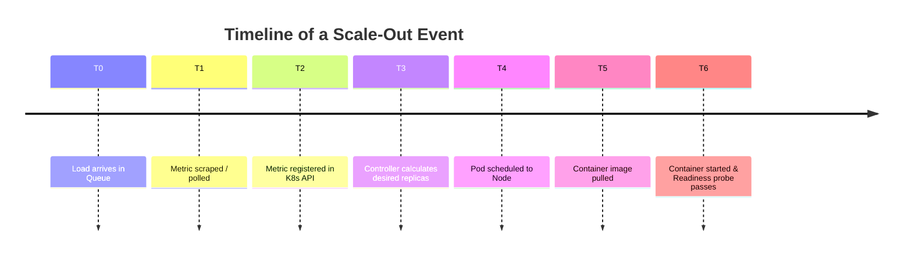
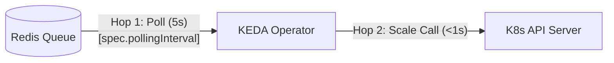
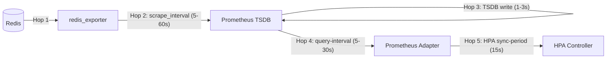
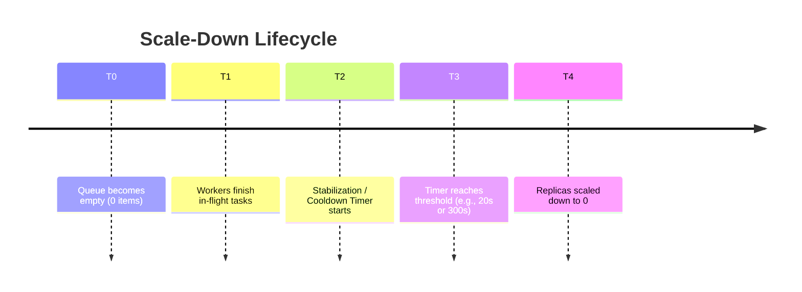

# Deep Dive: Scale-to-Zero and Scaling Latency in Kubernetes

A comprehensive guide explaining how **Scale-to-Zero (0 replicas)** works, the end-to-end **latency pipeline** for scaling up and down, and what can (and cannot) be configured in production across **KEDA** and **Native Kubernetes HPA**.

---

## 1. Scale-to-Zero: Architectural Comparison

Running zero pods when workloads are idle saves cloud compute costs and frees cluster capacity. However, Kubernetes was historically designed under the assumption that pods are always running.

### How KEDA Implements Scale-to-Zero

KEDA functions as an **Event-Driven Activator and Autoscaler**:



1. **Idle State (0 Replicas)**: When the queue is empty, KEDA scales the Deployment's scale subresource down to `0`. The associated HPA is either deactivated or paused.
2. **Activation ($0 \to 1$)**: The KEDA operator periodically polls Redis directly via `LLEN`. As soon as items appear, KEDA directly mutates the Deployment replica count from `0 \to 1`.
3. **Horizontal Scaling ($1 \to N$)**: Once at least 1 pod is active, KEDA delegates ratio-based scaling to Kubernetes HPA using an auto-generated internal HPA.
4. **Deactivation ($1 \to 0$)**: When the queue remains at 0 items for the duration of `cooldownPeriod`, KEDA steps in and scales the deployment back to 0.

---

### How Native HPA Implements Scale-to-Zero (Pre-v1.37 vs v1.37+)

#### Prior to Kubernetes v1.37
- Setting `minReplicas: 0` in an HPA was rejected by the API Server validation schema:
  `spec.minReplicas: Invalid value: 0: must be greater than or equal to 1`.
- The classic HPA formula $\lceil \text{currentReplicas} \times \frac{\text{currentMetric}}{\text{targetMetric}} \rceil$ resulted in a mathematical zero-trap ($0 \times \dots = 0$).

#### Starting in Kubernetes v1.37
- The **`HPAScaleToZero`** feature gate graduated to **Beta and is enabled by default**.
- **External and Object Metrics Only**: You can set `minReplicas: 0` when scaling on external metrics (e.g., `hpa_prometheus_queue_length` or AWS SQS).
- **CPU and Memory Still Forbidden**: You **cannot** use `minReplicas: 0` with resource metrics (CPU/Memory) because zero running pods emit zero metrics, making scale-up impossible.

---

### Scale-to-Zero Feature Matrix

| Feature | KEDA (`ScaledObject`) | Native HPA on K8s v1.37 (`autoscaling/v2`) |
| :--- | :--- | :--- |
| **`minReplicas: 0` Supported** | ✅ Yes (Native) | ✅ Yes (External/Object metrics only) |
| **Broker-Aware Activator** | ✅ Built-in (queries Redis directly) | ❌ No (relies on Prometheus Adapter) |
| **Separate Activation Threshold** | ✅ `activationListLength` (e.g., wake at 20 msgs, scale 1 per 100) | ❌ No (1 message triggers scale-up calculation) |
| **Required Dependencies** | KEDA Helm chart (~70MB) | Exporter + Prometheus Server + Prometheus Adapter (~400MB) |
| **Job Scaling (`ScaledJob`)** | ✅ Launches 1 run-to-completion K8s Job per message | ❌ Deployments/StatefulSets only |

---

## 2. End-to-End Scaling Latency ($T_{\text{Total}}$)

The total time required for an autoscaling event to serve traffic is divided into two distinct phases:

$$\mathbf{T_{\text{Total}}} = \mathbf{T_{\text{Decision}}} \ (\text{Metric \& Controller Pipeline}) + \mathbf{T_{\text{Provisioning}}} \ (\text{Container \& Node Startup})$$



---

### Phase 1: Metric Decision Latency ($T_{\text{Decision}}$)

#### Approach A: KEDA (2 Hops)
KEDA connects directly to the message broker over TCP/HTTP.



- **Hop 1: Polling Interval**: KEDA checks Redis `LLEN` every `pollingInterval` seconds (configured to **5s** in our PoC, default 30s).
- **Hop 2: API Mutation**: KEDA calls the Kubernetes API server `/scale` endpoint directly.
- **Decision Latency**: **~5 to 10 seconds**.

---

#### Approach B: Standard HPA + Prometheus (5 Hops)
Standard HPA requires metrics to traverse a multi-tier observability pipeline.



1. **Hop 1 (Exporter)**: `redis_exporter` queries Redis on request or internal cache.
2. **Hop 2 (Prometheus Scrape)**: Prometheus scrapes `/metrics` every `scrape_interval` (default: 15s to 60s; tuned to **5s** in this PoC).
3. **Hop 3 (TSDB Ingestion)**: Prometheus records the sample into its time-series buffer (1–3s).
4. **Hop 4 (Adapter Sync)**: Prometheus Adapter queries Prometheus via PromQL and caches the result for `custom.metrics.k8s.io` (default: 15–30s; tuned to **5s** in this PoC).
5. **Hop 5 (HPA Sync Loop)**: The Kubernetes `kube-controller-manager` evaluates the HPA loop every `--horizontal-pod-autoscaler-sync-period` (fixed at **15s**).
- **Decision Latency**:
  - **Aggressively tuned (our PoC)**: **~20 to 35 seconds**.
  - **Production defaults**: **~60 to 120 seconds**.

---

### Phase 2: Pod & Node Provisioning Latency ($T_{\text{Provisioning}}$)

Once the controller issues the order to scale from 0 to $N$, physical startup latency applies equally to both approaches:

| Component | Duration | Bottleneck / Determining Factors | Optimization Strategies |
| :--- | :--- | :--- | :--- |
| **Node Scheduling** | **< 1s** (capacity exists)<br>**30–90s** (new VM required) | Cluster Autoscaler, Karpenter, cloud VM provisioning times | Maintain warm buffer nodes or use fast provisioners (Karpenter) |
| **Container Image Pull** | **< 1s** (cached on node)<br>**10–30s** (remote pull) | Image layer size (50MB vs 1GB); network bandwidth | Use minimal base images (Alpine/Distroless), `imagePullPolicy: IfNotPresent` |
| **Application Boot** | **0.5s** (Go/Node/Scripts)<br>**20–45s** (JVM/Spring Boot) | Framework initialization, database connection pools | Native compilation (GraalVM, Go), deferred initialization |
| **Readiness Probe** | **2–10s** | `initialDelaySeconds`, `periodSeconds`, `failureThreshold` | Tune probe frequency for fast startup confirmation |

---

## 3. Scale-Down: Cooldown and Stabilization Windows

Scaling down too fast can cause **thrashing / flapping** (rapidly terminating pods only to re-create them seconds later). Kubernetes and KEDA employ stabilization windows to ensure queues stay empty before tearing down replicas.



### 1. KEDA Cooldown (`cooldownPeriod`)
Configured directly in `spec.cooldownPeriod`:
```yaml
spec:
  cooldownPeriod: 20  # Default: 300 (seconds)
```
KEDA requires the metric to remain below the activation threshold for `cooldownPeriod` consecutive seconds before triggering a scale-down to 0.

### 2. Standard HPA Stabilization Window (`behavior.scaleDown`)
Configured in `spec.behavior.scaleDown`:
```yaml
spec:
  behavior:
    scaleDown:
      stabilizationWindowSeconds: 20  # Default: 300 (seconds / 5 mins)
      policies:
      - type: Percent
        value: 100
        periodSeconds: 15
```
By default, Kubernetes HPA looks back over a **5-minute window** (`300s`) and picks the highest desired replica count calculated during that window. Setting `stabilizationWindowSeconds: 20` enables responsive scale-down for demos and agile queue processing.

---

## 4. Ratio-Based Scaling (1 Pod per $N$ Items)

Both tools allow configuring linear scaling based on queue depth:

$$\text{Desired Replicas} = \left\lceil \frac{\text{Total Queue Depth}}{N} \right\rceil$$

### In KEDA
```yaml
triggers:
- type: redis
  metadata:
    address: redis.common.svc.cluster.local:6379
    listName: keda-queue
    listLength: "100"           # 1 pod for every 100 items
    activationListLength: "20"  # Optional: Wake from 0 only when >= 20 items
```

### In Native HPA
```yaml
metrics:
- type: External
  external:
    metric:
      name: hpa_prometheus_queue_length
    target:
      type: AverageValue        # Tells HPA to divide metric by pod count
      averageValue: "100"       # 1 pod for every 100 items
```

---

## 5. Configuration Reference: What You Can vs Cannot Configure

| Parameter | Manifest / Configuration File | Tuned Value (This PoC) | Production Default | Can Modify on Cloud (EKS/GKE)? |
| :--- | :--- | :--- | :--- | :--- |
| **KEDA Polling Frequency** | `ScaledObject.spec.pollingInterval` | `5` (seconds) | `30` (seconds) | ✅ Yes |
| **KEDA Cooldown Window** | `ScaledObject.spec.cooldownPeriod` | `20` (seconds) | `300` (seconds) | ✅ Yes |
| **Prometheus Scrape Interval** | `server.global.scrape_interval` | `5s` | `15s`–`60s` | ✅ Yes |
| **Prometheus Adapter Sync** | `--prometheus-query-interval` | `5s` | `15s`–`30s` | ✅ Yes |
| **HPA Stabilization Window** | `behavior.scaleDown.stabilizationWindowSeconds` | `20` (seconds) | `300` (seconds) | ✅ Yes |
| **HPA Scale-Up Rate Limit** | `behavior.scaleUp.policies` | 100% every 15s | Conservative steps | ✅ Yes |
| **HPA Controller Evaluation Period** | `--horizontal-pod-autoscaler-sync-period` on `kube-controller-manager` | 15s | 15s | ❌ **No** (managed control plane flag) |

---

## 6. Summary Recommendations

- **Use KEDA when**:
  - You need low cold-start latency (< 10s) from 0 replicas.
  - You want out-of-the-box scalers for queues (Kafka, RabbitMQ, SQS, Redis) without deploying and managing Prometheus exporters.
  - You need advanced features like activation thresholds (`activationListLength`) or run-to-completion Jobs (`ScaledJob`).
- **Use Native HPA with Prometheus when**:
  - You already have an established Prometheus and Prometheus Adapter observability stack.
  - Your scaling logic requires complex math, multiple PromQL calculations, or internal application metrics (e.g., HTTP request rate per second).
  - Your cluster is running Kubernetes v1.37+ and a 20–35s decision latency is acceptable for your workloads.
