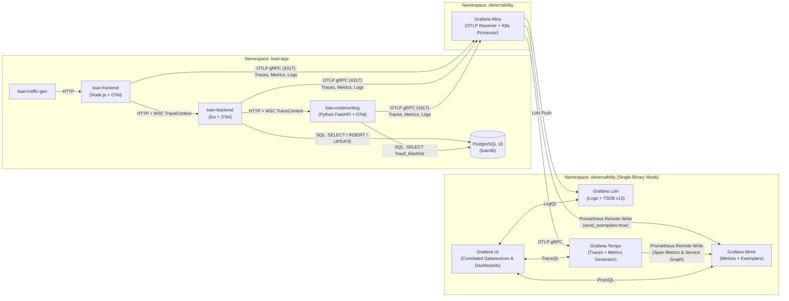

# POC Design for Grafana LGTM Stack on Local Kubernetes (Kind)

## 1. Overview & Objectives

This Proof of Concept (POC) demonstrates a full-fidelity **Grafana LGTM** observability stack (**L**oki, **G**rafana, **T**empo, **M**imir) with **Grafana Alloy** as the unified OpenTelemetry collector on a local **Kind** Kubernetes cluster.

### Key Requirements
- **Local Kind Kubernetes Cluster**: Running the latest available Kubernetes node image (`v1.35.x` / `v1.36.x`).
- **Helm-Based Deployment**: Official Grafana Helm charts for Loki, Tempo, Mimir, Alloy, and Grafana.
- **Polyglot Loan Microservices + PostgreSQL Database**:
  - `loan-frontend` (**Node.js / Express**): User-facing web portal & API gateway (`POST /api/loans/apply`, `GET /api/loans/history`).
  - `loan-backend` (**Go**): Core Loan Orchestrator & PostgreSQL persistence service (`POST /underwrite`, `GET /loans`).
  - `loan-underwriting` (**Python / FastAPI**): Dedicated Risk, Fraud Blacklist (PostgreSQL), and External Credit Bureau Engine (`POST /evaluate`).
  - `postgres` (**PostgreSQL 16**): Relational database storing `loan_applications` and `fraud_blacklist` to demonstrate SQL query latency analysis (`SELECT`, `INSERT`, `UPDATE`, slow `pg_sleep` queries, and SQL constraint errors).
  - `loan-traffic-gen`: Automated traffic generator continuously submitting normal, slow DB, fraud, timeout, and SQL error scenarios.
- **Unified Telemetry Collection**: Grafana Alloy receiving OTLP Logs, Metrics, and Traces + enriching with Kubernetes metadata.
- **Full Cross-Signal Correlation**:
  - **Metrics $\rightarrow$ Traces**: OpenTelemetry histogram **Exemplars** stored in Mimir linking directly to Tempo traces (including both end-to-end underwriting latency and PostgreSQL SQL query latency).
  - **Traces $\rightarrow$ Logs**: Tempo `tracesToLogsV2` jumping directly to Loki logs filtered by `service_name` and `trace_id`.
  - **Logs $\rightarrow$ Traces**: Structured JSON logs in Loki with `trace_id` extracted via `derivedFields` linking back to Tempo.
  - **Traces $\rightarrow$ Metrics**: Tempo `metrics-generator` producing **Span RED Metrics** (`traces_spanmetrics_*`) and **Service Graphs** (`traces_service_graph_*`) across `loan-frontend` $\rightarrow$ `loan-backend` $\rightarrow$ `loan-underwriting` $\rightarrow$ `postgresql` & `experian-credit-bureau`.

---

## 2. System Architecture

---

## 3. Presentation & Troubleshooting Scenarios

The application supports deterministic error and latency triggers based on either **`simulate_mode`** or **specific user input data**, ideal for live demos of Grafana LGTM:

| Scenario | Trigger via User Input | Trigger via Mode | Services & Spans Involved | Expected Telemetry Behavior |
| :--- | :--- | :--- | :--- | :--- |
| **1. Normal Approval / Review / Rejection** | Standard values (e.g. Score `760`, Amount `250000`) | `"normal"` | `loan-frontend` $\rightarrow$ `loan-backend` (`SELECT`, `INSERT`, `UPDATE`) $\rightarrow$ `loan-underwriting` (`SELECT fraud_blacklist`, `credit-bureau`, `pricing`) | `200 OK`, full 8+ span waterfall across 3 services + PostgreSQL |
| **2. Slow Database Query Bottleneck** | `amount > 900000` or Name with `"Slow"` | `"slow_db"` | `loan-backend` executes `postgres.slow_portfolio_exposure_analysis` (`SELECT pg_sleep(0.85), ...`) | ~850ms DB span clearly visible in Tempo waterfall + Exemplar spike on **PostgreSQL Query Latency** panel |
| **3. Fraud Blacklist Alert (`403`)** | Applicant Name containing `"Fraud"` or `"Blacklist"` | `"fraud_error"` | `loan-underwriting` queries `fraud_blacklist` table in PostgreSQL and raises `PermissionError` | `403 Forbidden`, red error spans in `loan-underwriting` & `loan-backend`, `SECURITY ALERT` JSON error log in Loki |
| **4. Credit Bureau Timeout (`504`)** | `credit_score < 450` | `"bureau_timeout"` | `loan-underwriting` span `credit-bureau.external_lookup` (`peer.service="experian-credit-bureau"`) times out | `504 Gateway Timeout`, red edge to `experian-credit-bureau` in Tempo Service Graph |
| **5. PostgreSQL SQL Constraint Error (`500`)** | `amount == 666` or `amount < 0` | `"db_error"` | `loan-backend` span `postgres.insert_loan_application` violates `CHECK (amount > 0 AND amount <> 666)` | `500 Internal Server Error`, PostgreSQL constraint exception recorded on span + `loan_db_errors_total` counter |
